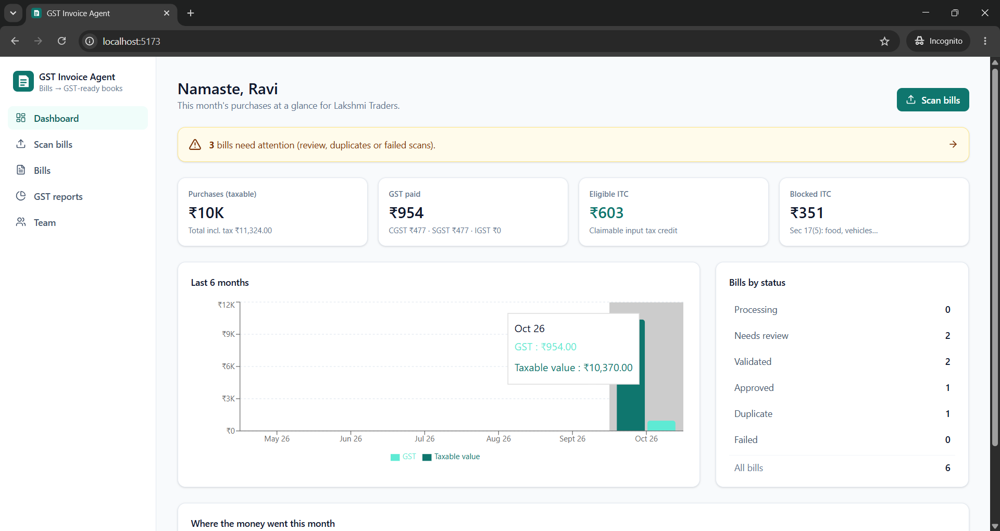
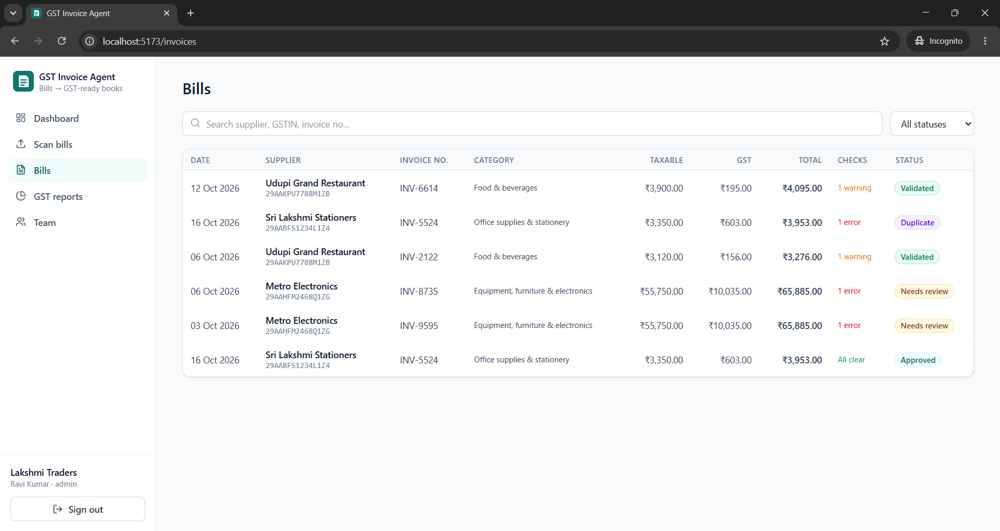
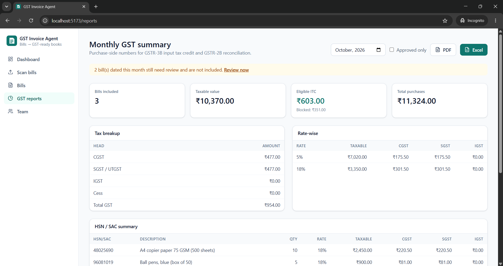
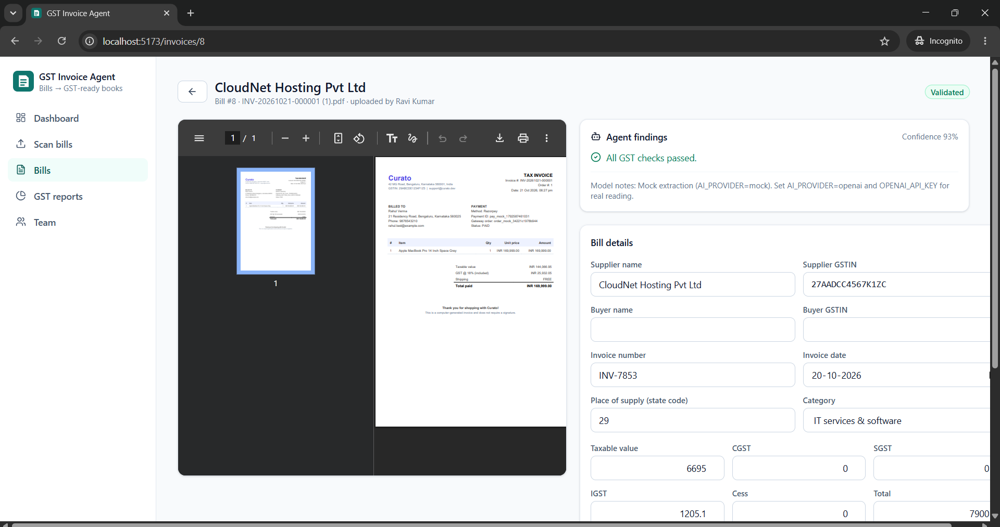
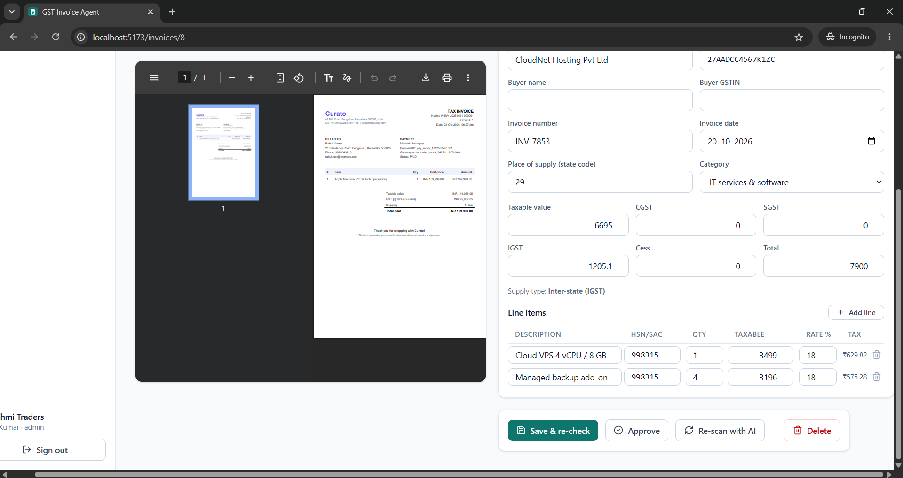
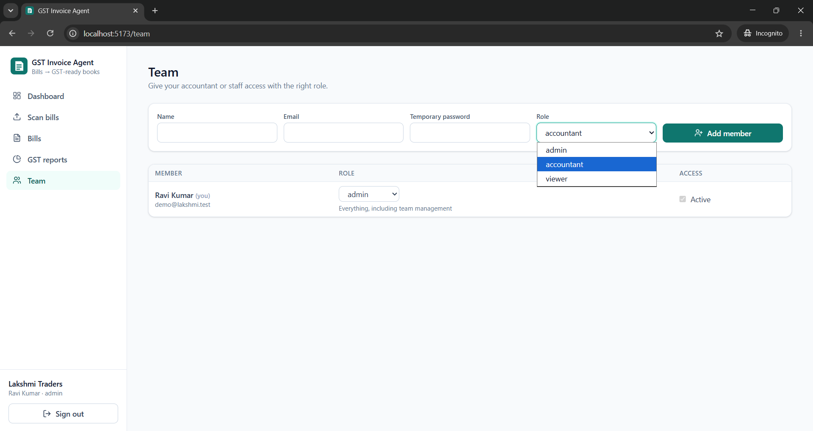
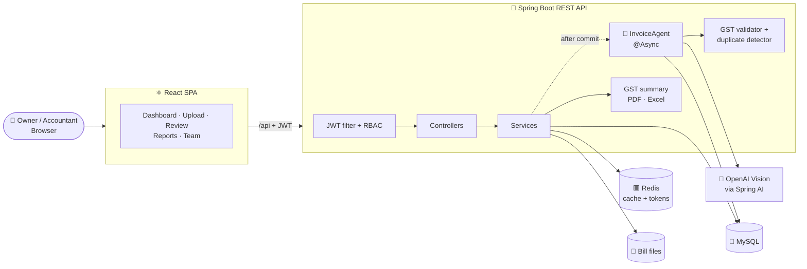
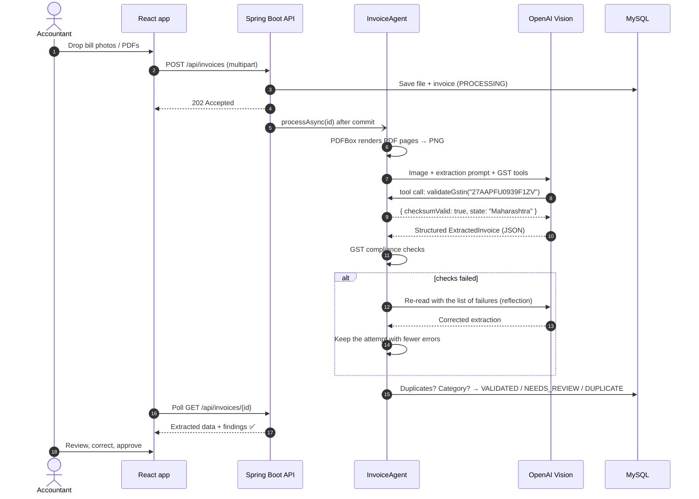
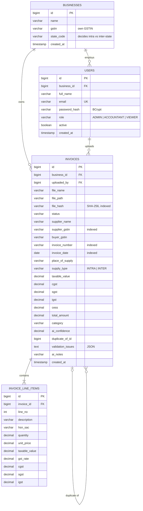

<div align="center">

# 🧾 GST Invoice Scanning AI Agent for Small Businesses

**An AI agent that turns photographed or PDF purchase bills into GST-ready books: vision-LLM extraction, GST
compliance checks, duplicate detection, expense categorization and monthly GST summaries in PDF and Excel.**


`Generative AI` · `AI Agents` · `Document AI` · `OCR` · `LLM` · `FinTech` · `GST`

</div>

## 📸 Demo

<table>
  <tr>
    <td align="center" width="33%">
      <a href="frontend/public/Images/Dashboard.png"></a>
      <br><b>Dashboard</b><br>
      <sub>Purchases, GST paid, eligible vs blocked ITC, 6-month trend, bills by status</sub>
    </td>
    <td align="center" width="33%">
      <a href="frontend/public/Images/Bills.png"></a>
      <br><b>Bills</b><br>
      <sub>Every scanned bill with category, tax, check results and status</sub>
    </td>
    <td align="center" width="33%">
      <a href="frontend/public/Images/GSTreports.png"></a>
      <br><b>Monthly GST reports</b><br>
      <sub>Tax breakup, rate-wise and HSN/SAC-wise summaries, PDF and Excel export</sub>
    </td>
  </tr>
  <tr>
    <td align="center" width="33%">
      <a href="frontend/public/Images/Scannedbill1.png"></a>
      <br><b>Bill review</b><br>
      <sub>Original bill side by side with the extracted fields and the agent's findings</sub>
    </td>
    <td align="center" width="33%">
      <a href="frontend/public/Images/Scannedbill2.png"></a>
      <br><b>Line items & actions</b><br>
      <sub>HSN/SAC lines, supply type, then save & re-check, approve or re-scan with AI</sub>
    </td>
    <td align="center" width="33%">
      <a href="frontend/public/Images/Team.png"></a>
      <br><b>Team & roles</b><br>
      <sub>Invite an accountant or viewer with role-based access</sub>
    </td>
  </tr>
</table>

<sub>Click any screenshot to view it full size.</sub>

---

## 📑 Table of contents

- [Overview](#-overview)
- [Features](#-features)
- [Tech stack](#-tech-stack)
- [System architecture](#-system-architecture)
- [AI agent flow](#-ai-agent-flow)
- [Database schema](#-database-schema)
- [Folder structure](#-folder-structure)
- [Getting started](#-getting-started)
- [Configuration](#-configuration)
- [API reference](#-api-reference)
- [Security](#-security)
- [Testing](#-testing)
- [Deployment](#-deployment)
- [Engineering highlights](#-engineering-highlights)
- [Future improvements](#-future-improvements)

---

## 🔎 Overview

Small businesses in India collect stacks of paper and PDF purchase bills. To claim **input tax credit (ITC)**, someone has
to type each bill into a spreadsheet, check that the supplier's GSTIN is valid, make sure the right tax was charged
(CGST + SGST or IGST), avoid entering the same bill twice and total everything up for the monthly return.

This project automates that with a **Spring Boot REST API** and a **React** frontend:

- 📷 **Document AI / OCR.** A **vision LLM** (OpenAI via **Spring AI**) reads the photo or PDF and returns structured data:
  - supplier and buyer GSTIN
  - invoice number and date, and place of supply
  - HSN/SAC line items, CGST/SGST/IGST/cess and totals
- 🤖 **A real AI agent, not a single prompt.**
  - While reading a bill, the model **calls GST tools** to check its own work: GSTIN checksum, tax maths, state lookup.
  - When the compliance checks fail, the agent **feeds the failures back** to the model for a focused re-read, and keeps whichever reading has fewer errors.
- ✔️ **Deterministic GST validation.** A rule engine makes the final call on correctness, so it never rests on the LLM alone.
- 📊 **GST-ready output.** It produces monthly summaries that support **GSTR-3B** ITC and **GSTR-2B** reconciliation, exported to PDF and Excel.

Access is secured with **JWT authentication** and **role-based access control** (Admin / Accountant / Viewer). Each business's data is
isolated from every other business. **Redis** caches the dashboard and stores refresh tokens and the token blacklist.

---

## ✨ Features

### 📷 Scanning & review

| Feature | Details |
|---|---|
| **Bulk upload** | Drag and drop up to 20 bills at once (PDF, JPG, PNG, WEBP; up to 10 MB each) |
| **AI extraction** | Supplier/buyer name and GSTIN, invoice no. and date, place of supply, line items with HSN/SAC, qty, rate and tax, plus totals |
| **Live status** | Bills are processed in the background, and the UI polls until each one is done |
| **Agent findings** | Every error and warning in plain English, with the model's confidence score and notes |
| **Side-by-side review** | The original bill (image or PDF) next to editable fields. Fields that failed a check are highlighted in red |
| **Save & re-check** | Corrections re-run every GST check immediately. Line tax is recalculated when the value or rate changes |
| **Approve workflow** | Validated bills can be approved. A reviewer can approve a bill that is wrong as printed, by explicitly accepting its issues |
| **Re-scan with AI** | Sends the original file through the agent again |

### 🧮 GST compliance engine

| Check | Details |
|---|---|
| **GSTIN** | 15-character format, valid state code and **mod-36 checksum**. A misread `0`/`O` is caught |
| **Tax type** | Same-state supply must charge CGST + SGST; inter-state supply must charge IGST. Never both |
| **CGST = SGST** | The two halves must match |
| **Line maths** | Taxable value × GST rate = tax charged on every line |
| **Totals** | Line items add up to the header, and taxable + tax = grand total (₹1 round-off tolerance) |
| **HSN / SAC** | 4/6/8-digit HSN for goods; 6-digit SAC starting with `99` for services |
| **GST rates** | Standard slabs, including the 2025 rate rationalization (5% / 18% / 40%) |
| **Dates** | Future dates are rejected; bills older than 2 years are warned about (ITC window) |
| **Buyer GSTIN** | Warns when a bill is addressed to a different GSTIN than your business |

### 🗂️ Duplicates & categorization

| Feature | Details |
|---|---|
| **Duplicate detection** | Three passes: identical file (SHA-256), then same supplier + invoice number, then same supplier + date + amount |
| **Expense categories** | 15 categories, assigned from HSN/SAC codes (weighted by value), then the LLM's suggestion, then keyword matching |
| **Blocked ITC** | Food & beverages and motor vehicles are flagged under **Section 17(5)** and kept out of eligible ITC |

### 📊 Reports & admin

| Feature | Details |
|---|---|
| **Dashboard** | This month's taxable purchases, GST paid, eligible and blocked ITC, a 6-month trend chart, bills by status and top categories |
| **Monthly GST summary** | Tax breakup, rate-wise, HSN/SAC-wise, category-wise and supplier-wise tables, plus a full invoice register |
| **PDF export** | A printable landscape report with Indian digit grouping (₹1,25,000.00) |
| **Excel export** | A 5-sheet workbook: Summary, Invoices, HSN Summary, Rate-wise and Supplier-wise |
| **Team management** | The admin adds members with a role, changes roles and deactivates accounts |

### ⚙️ Platform

| Feature | Details |
|---|---|
| **Mock AI mode** | `AI_PROVIDER=mock` returns realistic sample bills, so the whole flow is demoable without an API key |
| **Zero-setup profile** | The `h2` profile runs on an in-memory database. No MySQL or Redis needed |
| **Pluggable stores** | Cache and token store switch between Redis and in-memory with one setting each |
| **API docs** | OpenAPI 3 and Swagger UI with JWT auth built in |
| **Docker Compose** | MySQL, Redis, backend and frontend (Nginx) in one command |

---

## 🧰 Tech stack

| Layer | Technologies |
|---|---|
| **Frontend** | React 19, TypeScript, Vite 7, Tailwind CSS 4, React Router 7, Axios, Recharts, lucide-react |
| **Backend** | Java 21, Spring Boot 3.5, Spring Web MVC, Spring Data JPA (Hibernate), Bean Validation, `@Async` |
| **AI / Document AI** | **Spring AI 1.0** (ChatClient, multimodal input, structured output, `@Tool` calling) and the **OpenAI Vision API** (`gpt-4o-mini`) |
| **Documents** | Apache PDFBox (PDF → image for the vision model), OpenPDF (PDF reports), Apache POI (Excel reports) |
| **Auth** | Spring Security, JWT (jjwt 0.12) with refresh-token rotation, BCrypt, method-level `@PreAuthorize` |
| **Database** | MySQL 8 (production), H2 (zero-setup demo and tests), Flyway migrations |
| **Caching** | Redis 7: dashboard cache through Spring Cache, plus the refresh-token and blacklist store |
| **API docs** | springdoc-openapi (Swagger UI) |
| **Testing** | JUnit 5, Spring Boot Test, MockMvc, Spring Security Test, AssertJ |
| **DevOps** | Maven Wrapper, Docker, Docker Compose, Nginx, Spring Boot Actuator |

---

## 🏗️ System architecture



**Request path:** an upload stores the file and creates the invoice with status `PROCESSING`, then returns
`202 Accepted` immediately. Once the transaction commits, the **InvoiceAgent** picks the bill up on a background thread.
The frontend polls the bill's status and updates the list as each bill finishes.

---

## 🤖 AI agent flow



The model never decides on its own whether a bill is valid. It extracts the data and can verify its reading with tools,
but the **deterministic rule engine** gives the final verdict. That keeps the agent's output auditable.

---

## 🗄️ Database schema



**Design notes**

- **Multi-tenant by design.** Every query is scoped to the user's `business_id`. A bill from another business returns 404.
- **Invoice status lifecycle:** `PROCESSING → VALIDATED | NEEDS_REVIEW | DUPLICATE | FAILED → APPROVED`. Editing an
  approved bill re-runs the checks and clears the approval.
- **Validation issues** are stored as JSON (`code`, `severity`, `field`, `message`). The UI uses `field` to highlight the
  exact input that failed.
- **Composite indexes** on `(business_id, file_hash)`, `(business_id, supplier_gstin, invoice_number)` and
  `(business_id, invoice_date)` keep duplicate checks and monthly reports fast.
- **Money** is stored as `DECIMAL(15,2)` and handled as `BigDecimal`. Floating point is never used.
- **Schema changes are versioned** with Flyway (`db/migration/V1__init.sql`). Hibernate never alters the schema.

---

## 📁 Folder structure

```
gst-invoice-ai-agent/
├── backend/                                  # 🍃 Spring Boot REST API
│   ├── src/main/java/com/gstagent/
│   │   ├── GstInvoiceAgentApplication.java
│   │   ├── agent/
│   │   │   ├── InvoiceAgent.java             # 🤖 Orchestrator: extract → validate → reflect → decide
│   │   │   ├── OpenAiVisionExtractor.java    # Spring AI ChatClient + image input + structured output
│   │   │   ├── GstTools.java                 # @Tool: validateGstin, computeGst, stateForCode
│   │   │   ├── MockInvoiceExtractor.java     # Offline extractor for demos without an API key
│   │   │   ├── DocumentRasterizer.java       # PDFBox: PDF pages → PNG
│   │   │   ├── ExtractedInvoice.java         # Typed schema the LLM must fill
│   │   │   └── ExtractionMapper.java         # Normalizes LLM output (dates, GSTIN, money)
│   │   ├── validation/
│   │   │   ├── GstinValidator.java           # Format, state code, mod-36 checksum
│   │   │   ├── InvoiceValidator.java         # GST rule engine
│   │   │   ├── DuplicateDetector.java        # 3-pass duplicate detection
│   │   │   ├── ComplianceChecker.java        # Runs all checks, sets the status
│   │   │   └── ValidationIssue.java
│   │   ├── category/                         # ExpenseCategory (+ ITC eligibility), ExpenseCategorizer
│   │   ├── invoice/                          # Entity, repository, service, controller, DTOs, statuses
│   │   ├── report/
│   │   │   ├── GstSummaryService.java        # Monthly GST summary aggregation
│   │   │   ├── DashboardService.java         # Cached dashboard
│   │   │   ├── PdfReportGenerator.java       # OpenPDF
│   │   │   ├── ExcelReportGenerator.java     # Apache POI
│   │   │   └── ReportController.java
│   │   ├── auth/                             # JWT service + filter, refresh rotation, Redis/in-memory token store
│   │   ├── user/                             # User, Role, team management API
│   │   ├── business/                         # Business (tenant)
│   │   ├── storage/                          # File storage (local disk)
│   │   ├── config/                           # Security, OpenAPI, typed AppProperties
│   │   └── common/                           # ApiException + RFC 7807 ProblemDetail handler
│   ├── src/main/resources/
│   │   ├── application.yml                   # Default profile (MySQL)
│   │   ├── application-h2.yml                # Zero-setup demo profile
│   │   └── db/migration/V1__init.sql         # Flyway schema
│   ├── src/test/java/com/gstagent/           # Unit + integration tests
│   ├── Dockerfile
│   └── pom.xml
│
├── frontend/                                 # ⚛️ React + TypeScript + Tailwind SPA
│   ├── src/
│   │   ├── api/                              # Axios client (JWT + auto refresh), API types
│   │   ├── auth/AuthContext.tsx              # Session state, role checks
│   │   ├── components/                       # Layout, StatusBadge, Stat
│   │   ├── pages/
│   │   │   ├── DashboardPage.tsx             # KPIs, trend chart, categories
│   │   │   ├── UploadPage.tsx                # Drag & drop + live processing status
│   │   │   ├── InvoicesPage.tsx              # Search, filter, paginate
│   │   │   ├── InvoiceDetailPage.tsx         # Side-by-side review, edit, approve
│   │   │   ├── ReportsPage.tsx               # Monthly GST summary + PDF/Excel download
│   │   │   ├── TeamPage.tsx                  # Members and roles (admin)
│   │   │   └── LoginPage.tsx / RegisterPage.tsx
│   │   └── main.tsx                          # Routes + protected layout
│   ├── public/Images/                        # README screenshots
│   ├── nginx.conf                            # SPA + /api proxy (Docker)
│   └── Dockerfile
│
├── docker-compose.yml                        # MySQL + Redis + backend + frontend
├── .env.example                              # Configuration template
└── README.md
```

---

## 🚀 Getting started

### Prerequisites

- **Java 21+**
- **Node.js 20+**
- *Optional:* MySQL 8 and Redis 7 (or Docker). Without them, the `h2` profile runs everything in memory.
- *Optional:* an OpenAI API key. Without one, the **mock** AI mode is used.

### 1. Clone

```bash
git clone https://github.com/Sagan2k4/gst-invoice-ai-agent.git
cd gst-invoice-ai-agent
```

### 2. Start the backend. Pick one profile:

| Profile | Command (run in `backend/`) | Database | Cache / tokens | Best for |
|---|---|---|---|---|
| `h2` | `SPRING_PROFILES_ACTIVE=h2 ./mvnw spring-boot:run` | In-memory H2 | In-memory | Quick start, no installs |
| `local` | `SPRING_PROFILES_ACTIVE=local ./mvnw spring-boot:run` | **MySQL** | In-memory | MySQL installed, no Redis |
| *(default)* + Redis | `CACHE_TYPE=redis TOKEN_STORE=redis ./mvnw spring-boot:run` | **MySQL** | **Redis** | Full production-like stack |

> On Windows PowerShell, set the variable first: `$env:SPRING_PROFILES_ACTIVE="local"; .\mvnw.cmd spring-boot:run`

For the `local` profile, put your MySQL credentials in `backend/application-local.yml`. The file is **git-ignored**:

```yaml
spring:
  datasource:
    username: root
    password: "your-mysql-password"
```

The API starts on **http://localhost:8080**. On first run it creates the `gst_agent` database, and Flyway creates the tables.
Swagger UI is at **http://localhost:8080/swagger-ui.html**.

**Or run everything with Docker:**

```bash
cp .env.example .env          # set JWT_SECRET (openssl rand -base64 32)
docker compose up --build     # app → http://localhost:8081
```

### 3. Start the frontend

```bash
cd frontend
npm install
npm run dev                   # http://localhost:5173  (proxies /api → :8080)
```

### 4. Log in

| Role | How to get it |
|---|---|
| **Admin** | Click **Create an account**. Whoever registers a business becomes its admin |
| **Accountant** / **Viewer** | The admin adds them on the **Team** page |

> 💡 With `AI_PROVIDER=mock` (the default), uploads return realistic sample bills, so the whole flow works without
> any keys. One sample has a deliberate total mismatch, to show the review flow.

---

## 🔧 Configuration

Settings come from environment variables, `backend/application-local.yml` (git-ignored) or, for Docker Compose, the
root `.env` file (git-ignored).

| Variable | Purpose | Default |
|---|---|---|
| `DB_URL`, `DB_USERNAME`, `DB_PASSWORD` | MySQL connection | `localhost:3306/gst_agent`, `root` |
| `REDIS_HOST`, `REDIS_PORT` | Redis connection | `localhost`, `6379` |
| `CACHE_TYPE` | `redis` or `simple` (in-memory) dashboard cache | `simple` |
| `TOKEN_STORE` | `redis` or `memory` for refresh tokens and the blacklist | `memory` |
| `JWT_SECRET` | Base64 HMAC key (≥ 256 bits). **Always set in deployed environments** | dev key |
| `JWT_ACCESS_TTL`, `JWT_REFRESH_TTL` | Token lifetimes | `PT30M`, `P7D` |
| `AI_PROVIDER` | `openai` for real vision extraction, `mock` for sample data | `mock` |
| `OPENAI_API_KEY` | OpenAI key (needed when `AI_PROVIDER=openai`) | — |
| `OPENAI_MODEL` | Vision-capable chat model | `gpt-4o-mini` |
| `STORAGE_DIR` | Where uploaded bills are stored | `./uploads` |
| `CORS_ORIGINS` | Allowed browser origins | `http://localhost:5173` |

**Real AI extraction:** set `AI_PROVIDER=openai` and `OPENAI_API_KEY=sk-…`, restart the backend and upload a real GST bill.

---

## 📡 API reference

All endpoints are under `/api`. Errors are returned as RFC 7807 `application/problem+json`.
Interactive docs are at `/swagger-ui.html`.

| Method | Endpoint | Description | Access |
|---|---|---|---|
| `POST` | `/auth/register` | Create a business and its admin, returns tokens | Public |
| `POST` | `/auth/login` | Log in, returns access + refresh tokens | Public |
| `POST` | `/auth/refresh` | Rotate the refresh token, issue a new pair | Public (refresh token) |
| `POST` | `/auth/logout` | Blacklist the access token and revoke the refresh token | Public |
| `GET` | `/auth/me` | Current user and business | Signed in |
| `POST` | `/invoices` | Upload bills (multipart `files`, up to 20) → `202 Accepted` | Admin, Accountant |
| `GET` | `/invoices?status=&q=&from=&to=&page=` | Search, filter and page through bills | Signed in |
| `GET` | `/invoices/{id}` | Bill details, line items and validation findings | Signed in |
| `GET` | `/invoices/{id}/file` | Original uploaded file | Signed in |
| `PUT` | `/invoices/{id}` | Save corrections and re-run all checks | Admin, Accountant |
| `POST` | `/invoices/{id}/approve?acceptIssues=` | Approve a bill | Admin, Accountant |
| `POST` | `/invoices/{id}/reprocess` | Re-run the AI agent | Admin, Accountant |
| `DELETE` | `/invoices/{id}` | Delete a bill | Admin |
| `GET` | `/reports/dashboard` | Dashboard metrics (cached) | Signed in |
| `GET` | `/reports/monthly?month=YYYY-MM&approvedOnly=` | Monthly GST summary (JSON) | Signed in |
| `GET` | `/reports/monthly/pdf` · `/reports/monthly/excel` | Download the summary as PDF / Excel | Signed in |
| `GET` `POST` `PUT` | `/users`, `/users/{id}` | List, add and update team members | Admin |

<details>
<summary><b>Example: a processed bill</b></summary>

```http
GET /api/invoices/3
Authorization: Bearer <access-token>
```

```json
{
  "id": 3,
  "status": "NEEDS_REVIEW",
  "supplierName": "Metro Electronics",
  "supplierGstin": "29AAHFM2468Q1ZG",
  "invoiceNumber": "INV-8735",
  "invoiceDate": "2026-10-06",
  "supplyType": "INTRA",
  "taxableValue": 55750.00,
  "cgst": 5017.50,
  "sgst": 5017.50,
  "totalAmount": 65885.00,
  "category": "EQUIPMENT_AND_ASSETS",
  "aiConfidence": 0.930,
  "validationIssues": [
    {
      "code": "TOTAL_MISMATCH",
      "severity": "ERROR",
      "field": "totalAmount",
      "message": "Taxable value + taxes = 65785.00 but the bill total is 65885.00"
    }
  ],
  "lineItems": [
    { "description": "Laptop 14\" i5 16GB/512GB", "hsnSac": "84713010", "quantity": 1, "taxableValue": 52500.00, "gstRate": 18, "...": "..." }
  ]
}
```
</details>

---

## 🔐 Security

- **Stateless JWT authentication.**
  - Short-lived access tokens (30 min) and refresh tokens (7 days), both HMAC-signed.
  - Refresh tokens are **rotated** on every use, and only refresh tokens recorded in the token store are accepted.
- **Real logout.** Logout blacklists the access token's ID until it expires, in Redis or in memory.
- **RBAC at the method level** with `@PreAuthorize`:
  - **Admin**: everything.
  - **Accountant**: upload, edit, approve, reports.
  - **Viewer**: read-only.
- **Tenant isolation.** Every lookup is scoped to the caller's business, so another business's bill returns 404.
- **BCrypt** password hashing. Passwords are never logged or returned.
- **Upload hardening.**
  - Content-type allowlist (PDF, JPG, PNG, WEBP), a 10 MB per-file limit and a 20-file batch limit.
  - Server-generated file names, plus a path-traversal guard on reads.
- **LLM output is never trusted blindly.**
  - Every extracted value is normalized and re-validated by deterministic rules before it counts as valid.
  - GSTINs are cleaned of OCR noise and checksum-verified.
- **Input validation** with Bean Validation on every request DTO, and RFC 7807 error responses.
- **Secrets** come only from environment variables, the git-ignored `application-local.yml` or the git-ignored `.env`. None are committed.

---

## 🧪 Testing

```bash
cd backend
./mvnw test
```

15 tests run against an in-memory H2 database with the mock AI provider. They cover:

- ✅ GSTIN format, state code and **checksum**, including single-character misread detection and OCR-noise normalization
- ✅ GST rules: intra/inter-state tax type, CGST = SGST, line tax maths, totals with round-off tolerance, HSN/SAC
  validity, future dates and missing fields
- ✅ The full **register → upload → agent processing → duplicate detection → approve → monthly report (JSON, PDF,
  Excel) → dashboard** flow
- ✅ **Concurrency.** The same file uploaded twice in one batch flags only the later copy as a duplicate
- ✅ **RBAC.** A viewer can read bills but gets 403 on upload and team management. Anonymous users get 401
- ✅ **Logout** revokes the access token

---

## ☁️ Deployment

| Component | How |
|---|---|
| **All-in-one** | `docker compose up --build` runs MySQL 8.4, Redis 7.4, the backend and the frontend (Nginx) |
| **Backend** | `./mvnw package`, then run `target/gst-invoice-agent-*.jar` on any JVM host (Render, Railway, AWS EC2, …) with the environment variables above, pointing at managed MySQL and Redis |
| **Frontend** | `npm run build`, then serve `dist/` from any static host (Nginx, Netlify, Vercel, Cloudflare Pages). Set `VITE_API_URL` if the API is on another domain |
| **File storage** | Mount a persistent volume at `STORAGE_DIR` (the Compose file does this for you) |

---

## 💡 Engineering highlights

- **Agentic loop with a verifiable core.**
  - The LLM extracts and self-checks with **Spring AI tool calling**.
  - A deterministic rule engine judges the result.
  - On failure, the agent **reflects**: it sends the specific failures back for a focused re-read, then keeps the better of the two attempts.
- **Structured output, not free text.** The model fills a typed Java record (`ExtractedInvoice`), whose field
  descriptions become the JSON schema in the prompt.
- **No AI calls inside DB transactions.** The slow model call runs between short transactions, so one slow request
  can't use up the connection pool.
- **Start only after commit.** Background processing begins in `afterCommit()`, so the worker never reads a row that
  hasn't been saved yet.
- **Race-safe duplicate detection.** Only earlier bills (lower id) can be "originals". Two copies processed in parallel
  can never flag each other.
- **GST domain depth.**
  - GSTIN mod-36 checksum.
  - Supply type decided from the supplier's state vs the place of supply.
  - Section 17(5) blocked-ITC rules.
  - HSN/SAC-prefix categorization weighted by line value.
- **Report-ready money handling.** `BigDecimal` everywhere, ₹1 round-off tolerance, and Indian digit grouping in PDFs.
- **Runs anywhere.**
  - Mock AI mode, an H2 profile and in-memory fallbacks for cache and tokens let the same code run on a bare laptop or in production.
  - Docker Compose brings up the full stack.
- **Polished review UX.**
  - Inputs that failed a check are highlighted.
  - Line tax is recalculated live by supply type.
  - The UI polls for status during processing.
  - Responsive layout.

---

## 🔭 Future improvements

- GSTR-2B JSON import and automatic ITC reconciliation against supplier filings
- Live GSTIN status lookup via a GST Suvidha Provider (GSP) API
- Bill intake from WhatsApp and email inboxes
- Natural-language Q&A over your bills (*"How much GST did I pay on courier in Q2?"*)
- S3-compatible object storage and httpOnly-cookie refresh tokens
- CI/CD with GitHub Actions and containerized deployment

---

<div align="center">

**Built with ☕ Java, 🍃 Spring AI, ⚛️ React and 🐬 MySQL**

If you found this project interesting, please consider giving it a ⭐

</div>
